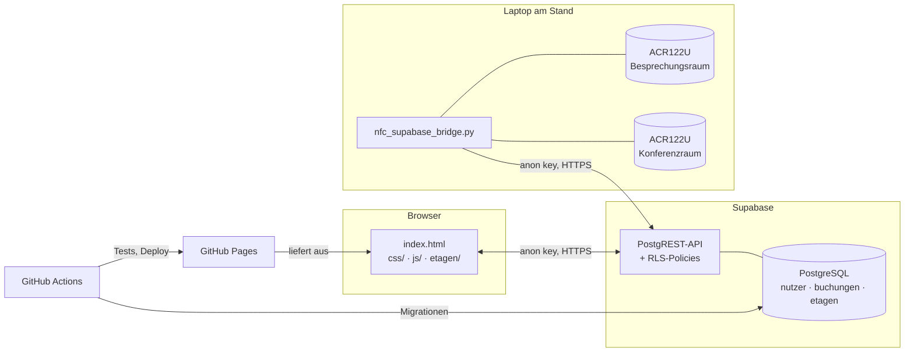

# 🏢 Raumbuchungssystem

**Räume und Einzeltische buchen – im Browser, auf einem interaktiven Grundriss oder einfach per NFC-Karte.**
Schulprojekt der Walther-Rathenau-Gewerbeschule (Fachinformatik Systemintegration) für die
Hausmesse 2026.

| | Link |
|---|---|
| 🌐 **Live-System** | <https://erschoenfeld2-tech.github.io/Raumbuchungssytem/> |
| 🧪 **Testsystem (ohne Anmeldung ausprobieren)** | <https://erschoenfeld2-tech.github.io/Raumbuchungssytem/?gast> |
| 🗺 Direkt zu einer Etage | `…/Raumbuchungssytem/?etage=hauptgebaeude-2` |

> Das **Testsystem** läuft auf derselben Datenbank, ist aber strikt vom Echtbetrieb getrennt.
> Jeder Gast bekommt eine **eigene Sitzung**: Er kann buchen und sogar eigene Etagen anlegen
> (die nur er sieht), alles mit einem Klick **zurücksetzen** und höchstens **10 Änderungen in
> 2 Minuten** machen. Gast-Buchungen werden nach 2 Minuten, Gast-Etagen nach 15 Minuten
> automatisch gelöscht. Räume mit NFC-Reader sind dort nur per Karte buchbar, damit sie für
> die Live-Demo am Stand frei bleiben.

---

## Inhalt

1. [Überblick](#1-überblick)
2. [Anleitung](#2-anleitung)
3. [Technische Beschreibung](#3-technische-beschreibung)
4. [Entwicklung, Tests und Betrieb](#4-entwicklung-tests-und-betrieb)

---

## 1. Überblick

### Was kann das System?

- **Buchen im Browser** – Raum, Tisch, Datum und Uhrzeit wählen, fertig. Doppelbuchungen und
  überbuchte Räume werden abgewiesen (im Browser *und* in der Datenbank).
- **Zwei Ansichten** – eine **Liste/Kalender** pro Etage (Belegung als farbige Blöcke: 1/2 =
  teilbelegt, 2/2 = voll) und ein **Grundriss**, in dem jeder Tisch per Klick auswählbar ist
  (grün = frei, rot = belegt).
- **Mehrere Gebäude und Etagen** – jede Etage ist eine eigene Datei (`etagen/*.js`) und hat ihre
  eigene Adresse (`?etage=<id>`). Neue Etagen entstehen aus einer Vorlage – oder ganz ohne
  Programmieren im Browser aus einem **Grundriss-Bild** oder einer **JSON-Datei**. Das kann jeder
  angemeldete Nutzer (dauerhaft, für alle sichtbar) und jeder Gast (nur für sich, mit Verfallszeit).
- **Mein Profil** – Profilbild, Nutzername und Passwort selbst ändern, dazu eine Übersicht aller
  eigenen Buchungen nach Tagen.
- **Bedienung** – Auswahllisten mit Gruppen, Frei/Belegt-Punkten, Häkchen und Suche; Häkchen als
  Schalter; vergangene Uhrzeiten werden ausgegraut.
- **NFC-Check-in** – Karte an den Reader am Raum halten → automatische 60-Minuten-Buchung,
  erneutes Auflegen verlängert. Die Buchung erscheint sofort im Browser (📡).
- **Persönliche Logins** – Passwörter werden gehasht in der Datenbank geprüft, beim ersten Login
  muss das Startpasswort geändert werden. Ein Admin darf alle Buchungen löschen, Etagen anlegen
  und das Testsystem verwalten.
- **Datenschutz** – Namen anderer Personen und Passwörter werden nie angezeigt: fremde Buchungen
  erscheinen nur als „belegt", eigene als „Du". Auch über die öffentliche Schnittstelle sind
  Nutzernamen nicht abrufbar.
- **Testsystem** für Messebesucher – ein Klick auf „Als Gast testen" oder der Link oben.
- **Dunkles Design**, läuft auf Desktop und Handy, kein App-Download nötig.

### So hängt alles zusammen



---

## 2. Anleitung

### 2.1 Für Nutzerinnen und Nutzer

1. **Anmelden** mit Nutzername und Passwort (Zugangsdaten gibt der Admin persönlich weiter).
   Beim ersten Mal wirst du aufgefordert, ein eigenes Passwort (mind. 6 Zeichen) zu wählen.
   Nur schauen? → **„👤 Als Gast testen"** (siehe 2.3).
2. **Gebäude/Etage wählen** über die Tabs oben (Gebäude-Tabs erscheinen, sobald es mehr als ein
   Gebäude gibt).
3. **Buchen**:
   - links im Formular Raum, Tisch, Datum und Zeit wählen und **✓ Buchen** klicken, *oder*
   - in der **Liste** in ein freies Feld klicken → freien Tisch für diese halbe Stunde buchen, *oder*
   - im **Grundriss** auf einen Tisch klicken → er wird ins Formular übernommen.
   - ShareDesks lassen sich auch **ganztägig** buchen.
4. **Eigene Buchungen** sind gelb umrandet und mit „Du" beschriftet, fremde heißen nur „belegt".
   Anklicken → Details → **Löschen**. Auf dem Handy steht oben eine anklickbare **Agenda** des Tages.
5. **Tischnummern**: `Etage.RaumTisch`, z. B. **1.203** = Etage 1, Raum 2, Tisch 3.
   Gebäude mit Kürzel bekommen ein Präfix, z. B. **A-0.201**.
6. **Auswahllisten**: Räume sind nach Meetingräumen und ShareDesks gruppiert; der Punkt zeigt die
   Belegung am gewählten Tag (grün frei, gelb teilweise, rot belegt), ✓ markiert die Auswahl.
   Bedienbar auch mit der Tastatur (↑ ↓ Enter Esc); lange Listen haben ein Suchfeld.
7. **Mein Profil**: Klick auf dein Bild/deinen Namen oben rechts.
   - **Profilbild** wählen oder entfernen (wird automatisch quadratisch verkleinert),
   - **Nutzername** ändern,
   - **Passwort** ändern (das aktuelle Passwort wird dabei verdeckt abgefragt),
   - **Meine Buchungen**: alle eigenen Buchungen ab heute nach Tagen, mit „Zum Tag →“ und Löschen.
   Name und Bild sieht nur du selbst – anderen wird nichts davon angezeigt.

### 2.2 NFC am Stand

1. Laptop mit den zwei ACR122U-Readern verbinden, `py list_readers.py` zeigt die Reader-Namen.
2. Namen in `nfc_bridge_config.py` (`READER_ZU_RAUM`) dem Raum zuordnen.
3. `py nfc_supabase_bridge.py` starten (Python **3.13**, `pip install pyscard requests`).
4. Karte auflegen → grüne LED = gebucht/verlängert, rote LED = unbekannte Karte oder Raum voll.

### 2.3 Testsystem (Gäste)

- **„👤 Als Gast testen"** startet eine eigene, geheime Gast-Sitzung (bleibt beim Neuladen erhalten).
- Gäste können buchen, ihre eigenen Test-Buchungen löschen und über **„＋ Etage / Gebäude"**
  bzw. **„✎ Etage bearbeiten"** eigene Etagen anlegen oder bestehende verändern – diese
  Änderungen sieht **nur die eigene Sitzung**, niemand sonst.
- **„↺ Meine Änderungen zurücksetzen"** löscht alle eigenen Test-Buchungen und Etagen sofort.
  Die Änderungen anderer Gäste bleiben bestehen, bis sie automatisch gelöscht werden
  (Buchungen nach 2 Minuten, Etagen nach 15 Minuten ohne Änderung).
- **Limit:** höchstens **10 Änderungen in 2 Minuten** je Gast (Buchen, Löschen, Etage speichern
  oder löschen). Der Banner zeigt, wie viele noch übrig sind; die Datenbank setzt das Limit durch.

**Admin im Testsystem:** Über **„🧪 Testsystem"** wechselt der Admin in die Testsystem-Ansicht,
sieht dort alle Test-Buchungen, darf jede davon löschen und mit **„🗑 Testsystem komplett leeren"**
alle Test-Buchungen und Gast-Etagen auf einmal entfernen (echte Buchungen bleiben unberührt).
**„🏢 Zurück zum Echtbetrieb"** wechselt zurück.

### 2.4 Neue Etage oder neues Gebäude (alle angemeldeten Nutzer)

| Wer | darf anlegen | darf ändern/löschen | sichtbar für | bleibt |
|---|---|---|---|---|
| Nutzer | X | - | - | - |
| Admin | ✓ | alle, auch Datei-Etagen ersetzen | alle | dauerhaft |
| Gast | ✓ | alles – aber nur in der eigenen Sitzung | nur sich selbst | 15 Min. ohne Änderung |

**Variante A – im Browser (ohne Programmieren):**

1. Anmelden → **„＋ Etage / Gebäude"**.
2. **Grundlage wählen:**
   - **🖼 Grundriss-Bild laden** (PNG, JPG, SVG, WebP – z. B. ein Foto oder Scan des Fluchtplans).
     Das Bild wird verkleinert und auf Wunsch fürs dunkle Design invertiert.
   - **📄 Datei importieren** – eine `.json`-Datei oder eine Etagen-Datei `.js` aus `etagen/`
     (wird nur gelesen, nie ausgeführt). Beispiel: `tests/fixtures/beispiel-etage.json`.
   - oder **Leer beginnen** – das System zeichnet Wände, Möbel und Fenster dann selbst.
3. **Gebäude** (neuer Name = neuer Gebäude-Tab), **Etagen-Nr.** (0 = Erdgeschoss) und Bezeichnung eintragen.
4. Auf der Fläche **Rechtecke aufziehen** = Räume. Anklicken = bearbeiten (Name, Typ
   *Meetingraum*/*ShareDesk*, Anzahl Tische, NFC-Reader), ziehen = verschieben, gelbe Ecke =
   Größe, `Entf` = löschen. „Beim Aufziehen anlegen als → Bereich" für Treppe, WC, Lounge …
5. **👁 Vorschau** zeigt die Etage genau so, wie sie später in der App aussieht.
6. **💾 Speichern** (dein Passwort wird in der Datenbank erneut geprüft – nach dem Neuladen der
   Seite wird es einmal verdeckt abgefragt) – die Etage ist sofort für alle sichtbar und buchbar.
   Alternativ **⬇ Etagen-Datei (.js)** exportieren und wie bei Variante B ins Repo legen.

Eigene Etagen lassen sich über **„✎ Etage bearbeiten"** anpassen oder löschen. Der Admin darf jede
Etage bearbeiten; eine von ihm gespeicherte Version ersetzt die Datei-Version mit gleicher ID,
„DB-Etage löschen" stellt die Datei-Version wieder her.

**Variante B – als Datei im Repository:**

1. `etagen/_vorlage-etage.js` kopieren, z. B. nach `etagen/werkstatt-etage-1.js`, Werte anpassen
   (alle Felder sind in der Vorlage erklärt).
2. In `index.html` im Block `<!-- ETAGEN -->` eine Zeile ergänzen:
   `<script src="etagen/werkstatt-etage-1.js"></script>`
3. `node tests/unit_tests.js` prüft die Datei (gültige Werte, eindeutige Raumnamen).
4. Committen, Pull Request, nach dem Merge ist die Etage live.

> **Wichtig:** Raumnamen müssen im ganzen System eindeutig sein, und die Raum-Nummern (`nr`)
> bestehender Räume nicht mehr ändern – sie stecken in den Tischcodes gespeicherter Buchungen.

### 2.5 Admin-Passwort

Das Admin-Passwort liegt seit Migration `20261119150000` nur noch als Hash in der Datenbank (vorher
stand es im Klartext im öffentlichen Frontend). Beim **ersten Admin-Login nach dem Deployment** gilt
noch das bisherige Passwort und muss sofort durch ein neues ersetzt werden – genau wie bei allen
anderen Nutzern. Die Seite zeigt Passwörter nie an; für Admin-Aktionen wird das Passwort aus der
Anmeldung verwendet (nur im Arbeitsspeicher) oder verdeckt abgefragt.
Passwort vergessen → im Supabase-SQL-Editor ein vorläufiges Passwort setzen (das beim nächsten
Login sofort geändert werden muss):
`update nutzer set passwort_hash = extensions.crypt('<vorläufiges-passwort>', extensions.gen_salt('bf')), passwort_muss_aendern = true where ist_admin;`

---

## 3. Technische Beschreibung

### 3.1 Aufbau des Repositorys

| Pfad | Inhalt |
|---|---|
| `index.html` | Seitengerüst der Live-App (Login, Formular, Ansichten, Dialoge, Etagen-Editor). Kein Build-Schritt, kein Framework. |
| `css/app.css` | Komplettes Styling (Dark-Theme, Mobil-Layout, Editor). |
| `js/config.js` | Supabase-URL + öffentlicher anon key, Konstanten (Zeitraum, Aktualisierungsintervall …). |
| `js/ui.js` | HTML-Escaping, Datum/Uhrzeit (lokale Zeit!), Toast, Dialoge, eigene Dropdowns (Gruppen, Status, Suche) und Zeitfelder. |
| `js/gebaeude.js` | **Etagen-Modell**: prüft und vereinheitlicht Datei- und Datenbank-Etagen → `ETAGEN`, `ROOMS`; Tischcodes. |
| `etagen/*.js` | **Eine Datei pro Etage** (`registriereEtage({...})`), `_vorlage-etage.js` = Vorlage. |
| `js/belegung.js` | Reine Logik ohne DOM/DB: gleichzeitige Belegung, Kapazitätsprüfung, Statusfarben, Kalender-Blöcke. |
| `js/grundriss.js` | Erzeugt das SVG einer Etage aus ihrer Definition (mit/ohne Hintergrundbild). |
| `js/kalender.js` | HTML der Listen-/Kalenderansicht und der Agenda. |
| `js/daten.js` | Alle Supabase-Zugriffe (Buchungen, Nutzer, Etagen, RPCs). |
| `js/auth.js` | Login, Passwortwechsel, Gast-Zugang, Sitzung im `localStorage`. |
| `js/editor.js` | Etagen-Editor (Bild-/Datei-Import, Zeichnen, Speichern, Export). |
| `js/profil.js` | Mein Profil: Bild, Nutzername, Passwort, Übersicht der eigenen Buchungen. |
| `js/hintergrund.js` | Animierter Netz-Hintergrund und Cursor-Spotlight. |
| `js/app.js` | Zustand, Gebäude-/Etagenwechsel, Rendern, Buchen, Ereignisse – startet die App. |
| `vendor/` | Supabase-JS-Client **2.119.0**, lokal mitgeliefert (keine CDN-Abhängigkeit am Stand). |
| `supabase/migrations/` | Datenbankschema als nummerierte SQL-Migrationen (Quelle der Wahrheit). |
| `nfc_supabase_bridge.py`, `nfc_bridge_config.py` | NFC-Brücke zum Live-System. |
| `tests/` | Unit-, SQL- und Browser-Tests (siehe 4.3). |
| übrige `*.py`, `index_lokal_modular.html` | **Alte Prototypen** (SQLite/FastAPI), nicht deployt, nur Referenz – siehe [`CLAUDE.md`](CLAUDE.md). |

Die Skripte sind bewusst klassische `<script>`-Dateien (keine ES-Module), damit `index.html` auch
direkt per Doppelklick (`file://`) funktioniert.

### 3.2 Datenmodell (Supabase / PostgreSQL)

| Tabelle/View | Spalten (Auszug) | Zugriff mit dem öffentlichen anon key |
|---|---|---|
| `nutzer` | `id, name, nfc_uid, ist_admin, passwort_hash, passwort_muss_aendern, bild` | **kein** direkter Zugriff (eigener Name/Bild nur über `nutzer_login`) |
| `nutzer_public` (View) | `id, name, ist_admin` | **gesperrt** (seit `20261119160000`) |
| `buchungen` | `id, raum, tisch, nutzer_id, name, start, ende, quelle ('web'/'nfc'), test, erstellt, gast_sitzung, gast_hash` | lesen ohne `name` und `gast_sitzung`; schreiben (siehe Einschränkung); Test-Buchungen nur per RPC |
| `etagen` | `id, definition (jsonb), aktualisiert, erstellt_von` | nur lesen; schreiben nur per RPC (angemeldete Nutzer: eigene, Admin: alle) |
| `gast_sitzungen`, `gast_etagen`, `gast_aenderungen` | Gast-Sitzungen, private Gast-Etagen, Änderungszähler | kein direkter Zugriff, nur per RPC |

`start`/`ende` sind Texte im Format `YYYY-MM-DD HH:MM` (lokale Zeit) – dadurch funktionieren
Überlappungsabfragen als einfacher Textvergleich.

**Funktionen (RPC, `security definer`):**
`nutzer_login` (liefert auch das eigene Profilbild), `nutzer_passwort_aendern` (bcrypt via pgcrypto),
`profil_speichern` (Name/Bild, mit Passwortprüfung), `nutzer_by_nfc` (Karten-UID →
Nutzer, ohne die UID-Liste preiszugeben), `test_buchungen_aufraeumen` (Gast-Buchungen > 2 Min),
`etage_speichern` / `etage_loeschen` (prüfen das Admin-Passwort serverseitig);
Testsystem: `gast_sitzung_starten`, `gast_buchen`, `gast_buchung_loeschen`, `gast_etagen_laden`,
`gast_etage_speichern`, `gast_etage_loeschen` (alle mit Limit 10 Änderungen / 2 Min. je Sitzung),
`gast_zuruecksetzen` (nur die eigene Sitzung), `testsystem_leeren` (Admin).
Die Gast-Sitzung ist eine geheime UUID; lesbar ist nur ihr SHA-256-Hash (`gast_hash`), an dem der
Browser die eigenen Test-Buchungen erkennt.

**Trigger `buchungen_pruefen`:** setzt `erstellt` immer serverseitig, verlangt `start < ende`,
lässt Test-Buchungen nur über `gast_buchen` zu und verhindert, dass derselbe Tisch für
überlappende Zeiten zweimal gebucht wird – auch wenn zwei Browser gleichzeitig klicken (pro Raum
serialisiert über einen Advisory-Lock).

### 3.3 Etagen-Format

```js
registriereEtage({
  id: 'hauptgebaeude-1', gebaeude: 'Hauptgebäude', nr: 1, name: 'Etage 1',
  breite: 960, hoehe: 480,                 // Zeichenfläche (SVG-Koordinaten)
  hintergrund: 'etagen/bilder/plan.png',   // optional: Grundriss-Bild
  aussenwand: {x, y, w, h}, flure: [...],  // optional
  raeume: [ {name, nr, typ:'meeting'|'sharedesk', tische, nfc, x, y, w, h, sub, sitze, stirn} ],
  bereiche: [ {typ:'treppe'|'wc'|'lounge'|'kueche'|'technik'|'sonstiges', name, x, y, w, h} ],
  tueren: [ {o:'h'|'v', x, y, len, s} ], texte: [ {x, y, t} ],
});
```

Alle Werte werden in `normalisiereEtage()` geprüft (Zahlenbereiche, erlaubte Typen, eindeutige
Namen/Nummern, nur `data:image/…` oder relative Bildpfade). Fehlerhafte Etagen werden übersprungen
und in der Browser-Konsole gemeldet, statt die Seite lahmzulegen. Datenbank-Etagen haben dasselbe
Format und ersetzen Datei-Etagen mit gleicher `id`.

### 3.4 Belegungs- und Kapazitätslogik

- Kapazität eines Raums = Anzahl seiner Tische (Meetingraum = 1).
- Eine neue Buchung ist erlaubt, wenn (a) der gewählte Tisch im Zeitraum frei ist und (b) die
  **höchste gleichzeitige** Belegung im Zeitraum unter der Kapazität liegt (`maxGleichzeitig`).
  NFC-Buchungen ohne Tisch zählen gegen die Raumkapazität.
- Dieselbe Logik steckt in `js/belegung.js` (`kapazitaetPruefen`) und in
  `nfc_supabase_bridge.py` (`freie_plaetze`) – Änderungen immer an beiden Stellen.
- Statusfarben: am heutigen Tag zählt die aktuelle Belegung, an anderen Tagen die höchste
  Belegung des Tages.

### 3.5 Sicherheitsmodell

- Der Supabase-**anon key ist öffentlich** (steht in `js/config.js`) – das ist bei Supabase so
  vorgesehen. Rechte regeln die Row-Level-Security-Policies und `security definer`-Funktionen.
- Passwörter (auch Admin) nur als bcrypt-Hash, Prüfung ausschließlich in der Datenbank.
- Karten-UIDs (`nfc_uid`) und Nutzernamen sind über den anon key nicht auslesbar; die Seite zeigt
  nur den eigenen Namen, fremde Buchungen als „belegt".
- Gast-Sitzungen sind geheime Zufalls-IDs; private Gast-Etagen und das Zurücksetzen hängen daran,
  das Änderungslimit prüft die Datenbank.
- Alle Texte aus Datenbank und Etagen-Dateien werden vor der Anzeige escaped; importierte
  Etagen-Dateien werden geparst, nie ausgeführt.
- **Bekannte, bewusst akzeptierte Einschränkung:** Es gibt keine echte Supabase-Auth-Sitzung.
  Die Policies auf `buchungen` sind daher offen (`using (true)`); „nur eigene Buchungen löschen"
  wird in der Oberfläche durchgesetzt, nicht in der Datenbank. Wer den anon key direkt gegen die
  REST-API benutzt, könnte das umgehen. Ebenso kann ein Gast durch eine neue Sitzung das
  Änderungslimit neu starten. Eine Lösung wäre echte Supabase-Auth (siehe `CLAUDE.md`).

---

## 4. Entwicklung, Tests und Betrieb

### 4.1 Voraussetzungen

- **Live-System:** nur ein Browser – `index.html` öffnen (oder `python3 -m http.server` im
  Repo-Ordner und <http://localhost:8000> aufrufen).
- **NFC-Brücke:** Python **3.13** (nicht 3.14 – für `pyscard` gibt es dort noch keine Wheels),
  `pip install pyscard requests`, ACR122U-Reader.
- **Tests:** Node.js 22, PostgreSQL 16 (Server + `psql`), Playwright mit Chromium
  (`npm i -g playwright && npx playwright install chromium`), Python 3.
- **Alte Prototypen:** `pip install fastapi uvicorn pydantic pyscard` je nach Skript (kein
  `requirements.txt`, Abhängigkeiten stehen im Docstring jeder Datei).

### 4.2 Umgebungsvariablen

**Keine.** Supabase-URL und anon key stehen in `js/config.js` bzw. `nfc_supabase_bridge.py`
(bewusst öffentlich, siehe 3.5). Die alten Prototypen nutzen `config.py` statt `.env` – dort
niemals echte SMTP-Zugangsdaten eintragen, das Repo ist öffentlich.

### 4.3 Tests

```bash
bash tests/run_tests.sh
```

| Stufe | Datei | Prüft |
|---|---|---|
| Unit | `tests/unit_tests.js` | alle eingebundenen Etagen-Dateien (gültig, eindeutige Namen, **Tischcodes unverändert**), Etagen-Prüfung, Kapazitätslogik, Datums-/Zeit-Helfer, Escaping |
| NFC-Brücke | `tests/bridge_tests.py` | Kapazitätslogik der Brücke = Logik im Browser |
| Migrationen | `tests/run_tests.sh` | alle Migrationen auf **frischer** Datenbank, neue zusätzlich ein zweites Mal (idempotent) |
| SQL | `tests/sql_tests.sql` | als Rolle `anon`: Admin-Login, Passwortwechsel, Etagen-Rechte, Doppelbuchungs-Trigger, `erstellt`, Aufräumen |
| Browser | `tests/e2e_tests.js` | Chromium klickt alle Abläufe durch (Login, Buchen, Kapazität, Grundriss, Etagenwechsel, Türen überdecken nichts, Löschen, Datenschutz/XSS, zwei Gäste mit privaten Etagen, Zurücksetzen, Limit, Admin, Admin im Testsystem, Editor mit Bild-/JSON-Import, Export, Löschen) und speichert Screenshots in `tests/screenshots/` |

Die Browser-Tests leiten alle Supabase-Aufrufe über `tests/mini_postgrest.js` auf eine **lokale**
Test-Datenbank um (`tests/supabase_stub.sql` bildet die Supabase-Rollen nach) – die echte
Datenbank wird nie angefasst. Ohne gesetztes `PGHOST` startet das Skript einen temporären
PostgreSQL-Server in `/var/tmp/rb-pgtest`.

In der CI laufen bei jedem Push/PR (`.github/workflows/ci.yml`):

- **Quality-Check** (`quality.yml`, auch Gate vor jedem Deployment): `py_compile` aller
  Python-Dateien, `node --check` für `js/`, `etagen/`, `tests/`, Unit- und Brücken-Tests,
  Existenz aller in `index.html` eingebundenen Dateien, HTML-Wohlgeformtheit, YAML/TOML,
  Migrations-Namenskonvention und riskante Statements.
- **Komplette Testsuite** mit PostgreSQL-Service und Chromium; Screenshots als Artefakt.

### 4.4 Datenbankmigrationen

Neue Schema-Änderungen kommen **immer** als neue Datei nach `supabase/migrations/`:

```
supabase/migrations/YYYYMMDDHHMMSS_kurze_beschreibung.sql
```

- Zeitstempel größer als der der letzten Migration
- Bestehende Migrationen **nie** nachträglich bearbeiten – stattdessen eine korrigierende neue anlegen
- Idempotent schreiben (`if not exists`, `on conflict do nothing`, `create or replace`, `drop … if exists`)
- Vorher lokal testen: `bash tests/run_tests.sh` (wendet alle Migrationen auf eine frische DB an)

Angewendet werden sie automatisch per `.github/workflows/supabase-deploy.yml` (Supabase CLI
`supabase db push`) bei jedem Push nach `main`, der `supabase/migrations/**` ändert – nach
bestandenem Quality-Check. Schritt-für-Schritt-Einrichtung: [`CICD_ANLEITUNG.md`](CICD_ANLEITUNG.md).

### 4.5 GitHub-Pages-Deployment

`.github/workflows/pages-deploy.yml` läuft bei jedem Push nach `main`, prüft zuerst die
Quality-Checks und veröffentlicht dann `index.html`, `css/`, `js/`, `etagen/`, `vendor/` und
`.nojekyll` (nicht die Python-Skripte oder Doku). Manuell auslösbar über den Actions-Tab.

**Einmalige Einrichtung:** Settings → Pages → Source von „Deploy from a branch" auf
**„GitHub Actions"** umstellen. Bis dahin liefert GitHub den `main`-Branch wie bisher direkt aus
(funktioniert ebenfalls, dann sind allerdings alle Repo-Dateien abrufbar).

### 4.6 Benötigte GitHub Secrets

| Secret | Wofür | Woher |
|---|---|---|
| `SUPABASE_ACCESS_TOKEN` | Authentifizierung der Supabase-CLI in der Pipeline | [supabase.com/dashboard/account/tokens](https://supabase.com/dashboard/account/tokens) |
| `SUPABASE_DB_PASSWORD` | Datenbank-Passwort für `supabase db push` | Supabase-Projekt → *Project Settings → Database* |

Die Projekt-Referenz (`yugjccgblqsfjasienwa`) steht direkt im Workflow – sie ist nicht geheim, da
sie ohnehin Teil der öffentlichen Supabase-URL ist.

### 4.7 Manuelle Repository-Einstellungen

- **Settings → Secrets and variables → Actions**: die beiden Secrets oben anlegen
- **Settings → Environments**: optional ein Environment `production` (z. B. mit Pflicht-Reviewer
  für Datenbank-Deployments) – ohne läuft die Pipeline automatisch weiter
- **Settings → Pages**: Source auf „GitHub Actions" (siehe 4.5)
- Repo-Sichtbarkeit **öffentlich**, damit GitHub Pages ohne kostenpflichtigen Plan funktioniert

### 4.8 Branch- und Pull-Request-Workflow

- Niemals direkt auf `main` committen – eigener Branch (`fix/…`, `feat/…`, `refactor/…`)
- Commit-Nachrichten nach [Conventional Commits](https://www.conventionalcommits.org/)
  (`fix:`, `feat:`, `refactor:`, `docs:`, `ci:`, `test:`)
- Pull Request gegen `main`, CI muss grün sein

### 4.9 Troubleshooting

**Seite zeigt alte Version / 404** – harter Reload (Strg+Shift+R); im Actions-Tab prüfen, ob der
letzte Pages-Workflow grün ist; Settings → Pages kontrollieren.

**„Supabase ist nicht erreichbar oder nicht konfiguriert"** – `js/config.js` prüfen; fehlt
`vendor/supabase-js-2.119.0.min.js`, kann der Client nicht laden.

**Admin-Login klappt nicht** – Sind die Migrationen deployt (Actions → „Supabase Schema Deploy")?
Vor `20261119150000` kennt `nutzer_login` keine Admins. Beim ersten Login nach dem Deployment gilt
das bisherige Admin-Passwort, danach das neu gewählte. Zurücksetzen: siehe 2.5.

**Login schlägt fehl trotz korrektem Passwort** – Der Name wird ohne Groß-/Kleinschreibung
verglichen, muss aber exakt existieren (im Supabase-SQL-Editor: `select name from nutzer;`).

**Gast: „Limit erreicht"** – gewollt: höchstens 10 Änderungen in 2 Minuten je Gast-Sitzung.
Kurz warten; der Zähler läuft automatisch ab.

**Neue Etage erscheint nicht** – Browser-Konsole öffnen: `[Etagen] … ignoriert: …` nennt den
Grund (z. B. doppelter Raumname). Bei Datei-Etagen `node tests/unit_tests.js` ausführen und
prüfen, ob die Datei in `index.html` eingetragen ist.

**„Tisch … ist in diesem Zeitraum bereits belegt" beim Buchen** – gewollt: jemand anderes war
schneller (der Datenbank-Trigger verhindert Doppelbuchungen).

**„null value in column … violates not-null constraint"** – Die Tabellenstruktur in Supabase
weicht ab. Mit `select column_name, is_nullable from information_schema.columns where table_name='buchungen';`
prüfen und eine korrigierende Migration ergänzen.

**NFC-Karte wird nicht erkannt** – `py list_readers.py` prüft, ob der Reader erkannt wird (USB,
Treiber). Die Brücke meldet unerwartete Fehler jetzt in der Konsole (`⚠ Unerwarteter Fehler`).

**Karte erkannt, aber Nutzer „unbekannt" / Check-in schlägt fehl** – (1) Ist die UID in
`nutzer.nfc_uid` hinterlegt? (2) Ist die RPC `nutzer_by_nfc` deployt? (3) Steht der Raumname in
`nfc_bridge_config.py` exakt so wie in der Etagen-Datei, und ist seine Kapazität in
`RAUM_KAPAZITAET` eingetragen?

### 4.10 Messeplakate (Hausmesse)

Im Ordner `Plakat/` liegen zwei Plakate im Stil der Messeseite. Jedes ist eine einzelne HTML-Datei
ohne Build-Schritt; die PDFs daraus sind Vektorgrafik (Text, QR-Codes, Grafiken) und lassen sich
ohne Qualitätsverlust auch kleiner drucken.

| Plakat | Format | Dateien |
|---|---|---|
| **Messeplakat** – Blickfang „Ein Tap. Ein Raum.“ mit NFC-Karte, Grundriss und QR-Code zur Web-App | DIN A1 hoch | `plakat.html`, `Plakat_Raumbuchungssystem_A1.pdf`, `…_A1_Beschnitt3mm.pdf`, `…_A1_300dpi.jpg` |
| **Infoplakat** (Rückwand am Stand) – QR-Codes zu Hausmesse-Seite, Web-App und GitHub-Repo, Anleitung in 4 Schritten, NFC-Check-in, Technik | DIN A0 hoch | `infoplakat.html`, `Infoplakat_Raumbuchungssystem_A0.pdf`, `…_A0_Beschnitt3mm.pdf`, `…_A0_150dpi.jpg` |

- **Druck:** das normale PDF; verlangt die Druckerei Beschnitt, die `…_Beschnitt3mm.pdf`
  (3 mm rundum). Die JPGs nur für Druckdienste, die kein PDF annehmen.
- **Texte ändern:** HTML-Datei in Chrome/Edge öffnen → Drucken → „Als PDF speichern“, Ränder
  „Keine“, Hintergrundgrafiken an (Papierformat kommt automatisch; mit `?beschnitt=3` an der
  Adresse inklusive Beschnitt).
- **QR-Codes** sind als fertige Matrizen eingebettet (`QR_MATRIX` bzw. `QR_DATEN`). Ändert sich
  eine Adresse, müssen sie neu erzeugt werden – Ziele: `https://hausmesse.wara.de/Stand23/index.html`,
  `https://erschoenfeld2-tech.github.io/Raumbuchungssytem/`,
  `https://github.com/erschoenfeld2-tech/Raumbuchungssytem`.
